# Мониторинг микросервиса: Observability для FastAPI

## 1. Цель и результат работы

Цель лабораторной — развернуть локальный стенд наблюдаемости для HTTP-микросервиса и проверить, как по метрикам, логам и распределённым трассировкам находить и объяснять проблемы приложения.

В качестве приложения используется сервис на **FastAPI**. На главной странице есть три действия для воспроизведения типичных ситуаций:

- `/error` — намеренно возвращает HTTP 500;
- `/delay` — добавляет задержку примерно на 1–3 секунды. В трассировке задержка выделяется отдельным вложенным спаном `slow-dependency`;
- `/load` — отправляет пакет из 20 запросов, создавая кратковременный всплеск нагрузки.

Вокруг приложения собран стек:

| Компонент | Роль |
|---|---|
| FastAPI | Микросервис и источник телеметрии |
| Prometheus | Сбор и хранение временных рядов, RED-метрики |
| Grafana | Дашборды и визуальный анализ метрик |
| Jaeger | Приём и просмотр трассировок через OTLP gRPC |
| Loki | Хранение и поиск логов |
| Promtail | Чтение логов и отправка их в Loki |
| Alertmanager | Группировка и маршрутизация алертов Prometheus |

Инфраструктура развёрнута локально на **macOS (MacBook Air)** с помощью Docker Desktop и Docker Compose. Это учебный стенд, а не готовая production-конфигурация.

## 2. Архитектура и потоки телеметрии

В системе используются три взаимодополняющих типа данных:

1. **Метрики.** FastAPI публикует их на `/metrics`. Prometheus периодически опрашивает endpoint и сохраняет значения. Grafana обращается к Prometheus и строит графики.
2. **Трейсы.** Приложение отправляет распределённые трассировки в Jaeger по OTLP gRPC. Trace состоит из спанов, описывающих операции внутри обработки запроса. У `/delay` можно отдельно увидеть `slow-dependency`.
3. **Логи.** Приложение пишет структурированные JSON-сообщения. Promtail читает доступный источник логов и передаёт записи в Loki. Поле `trace_id` позволяет связать запись с трассировкой в Jaeger.
4. **Алерты.** Prometheus вычисляет правила из конфигурации и отправляет сработавшие события в Alertmanager. Последний отвечает за группировку, подавление повторов и маршрутизацию уведомлений.

```text
                         ┌──────────────────────┐
                         │       FastAPI        │
                         │ /error /delay /load  │
                         │       /metrics       │
                         └───────┬───────┬──────┘
                                 │       │
                    metrics      │       │ traces (OTLP gRPC)
                                 ▼       ▼
                          ┌──────────┐ ┌──────────┐
                          │Prometheus│ │  Jaeger  │
                          └────┬─────┘ └──────────┘
                               │ PromQL
                               ▼
                          ┌──────────┐
                          │ Grafana  │
                          └──────────┘

       JSON logs ──> Promtail ──> Loki
       Prometheus ── alert rules ──> Alertmanager
```

Метрики отвечают на вопрос «что и насколько часто происходит», трейсы — «где именно внутри запроса потрачено время или возникла ошибка», логи — «какое событие зарегистрировало приложение и с каким контекстом».

## 3. Подготовка проекта на macOS

### 3.1. Проверка окружения

Перед началом работы были установлены и запущены Docker Desktop и Git. Из терминала проверил доступность инструментов:

```bash
docker --version
docker compose version
git --version
docker info
```

`docker info` проверяет не только наличие CLI, но и доступность Docker Engine. Если команда не может подключиться к daemon, сначала нужно запустить Docker Desktop и дождаться окончания инициализации.

### 3.2. Создание структуры каталогов

Проект был вынесен в отдельную директорию. Команды ниже показывают воспроизводимый вариант структуры; если в репозитории уже используются другие имена каталогов, следует сохранить фактическую структуру проекта.

```bash
mkdir -p ~/monitoring-lab
cd ~/monitoring-lab
mkdir -p app prometheus grafana/provisioning/datasources
mkdir -p grafana/provisioning/dashboards loki promtail alertmanager images
```

Конфигурации компонентов удобно хранить отдельно: это упрощает поиск ошибок и позволяет менять настройки Prometheus, Loki или Promtail независимо друг от друга.

Пример структуры:

```text
monitoring-lab/
├── app/                 # FastAPI, зависимости и Dockerfile
├── prometheus/          # prometheus.yml и правила алертов
├── grafana/             # provisioning источников и дашбордов
├── loki/                # конфигурация Loki
├── promtail/            # конфигурация агента логов
├── alertmanager/        # конфигурация Alertmanager
├── images/              # скриншоты для README
├── docker-compose.yml
└── README.md
```

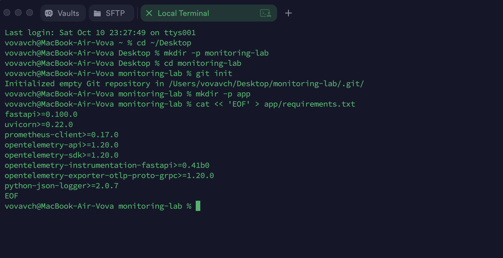

### 3.3. Инициализация Git и публикация на GitHub


```bash
git init
git status
git add .
git commit -m "Initial monitoring stack"
```

```bash
git add app/
git commit -m "Add FastAPI service and telemetry"
git add prometheus/ grafana/
git commit -m "Configure Prometheus and Grafana"
git add loki/ promtail/ alertmanager/
git commit -m "Configure logs and alerting"
```


```bash
git remote add origin 
git branch -M main
git push -u origin main
```

```bash
git config user.name "Your Name"
git config user.email "your-email@example.com"
```

Файл `.env` с паролями нужно добавить в `.gitignore`.

## 4. Контейнеризация FastAPI

Приложение запускается в отдельном контейнере. Dockerfile определяет базовый Python-образ, рабочую директорию, установку зависимостей и команду запуска. Пример минимальной основы:

```dockerfile
FROM python:3.11-slim
WORKDIR /app
COPY requirements.txt .
RUN pip install --no-cache-dir -r requirements.txt
COPY . .
CMD ["uvicorn", "main:app", "--host", "0.0.0.0", "--port", "8000"]
```

Параметр `--host 0.0.0.0` здесь принципиален: приложение должно принимать соединения от других контейнеров Docker-сети. Если привязать Uvicorn только к `127.0.0.1`, запросы из соседнего контейнера не смогут обратиться к сервису через сетевой интерфейс контейнера.

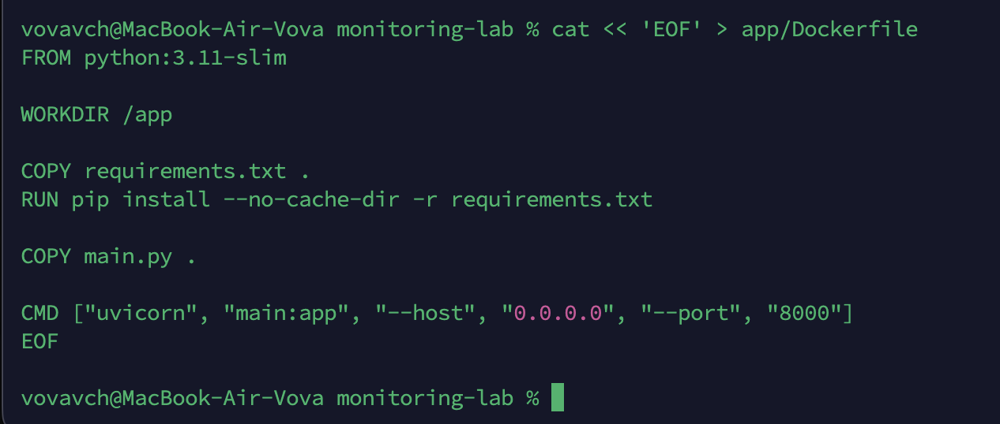

После сборки можно проверить доступность приложения запросами (предполагается, что порт контейнера 8000 опубликован на host-порт 8000):

```bash
curl -i http://localhost:8000/
curl -i http://localhost:8000/error
curl -i http://localhost:8000/delay
curl -i http://localhost:8000/load
```

Ожидаемое поведение: главная страница открывается; `/error` возвращает 500; `/delay` отвечает с искусственной задержкой; `/load` генерирует серию из 20 запросов. Эти endpoint нужны не как бизнес-функциональность, а как управляемые тестовые воздействия на систему.

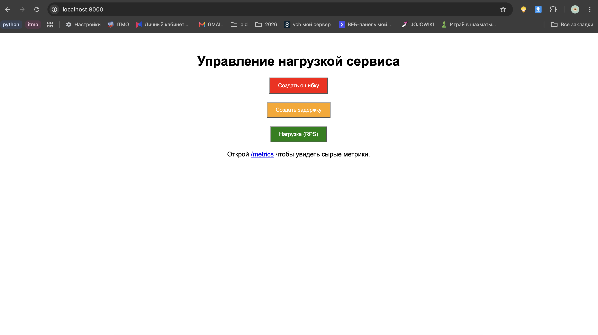

## 5. Запуск инфраструктуры через Docker Compose

Docker Compose описывает сервисы, сети, порты, переменные окружения и тома в одном YAML-файле. Поэтому весь стенд можно поднимать и останавливать согласованно.

Основная команда сборки и запуска:

```bash
docker compose up -d --build
```

`up` создаёт и запускает сервисы, `-d` переводит их в фоновый режим, `--build` пересобирает образы перед запуском. После этого проверяется состояние контейнеров:

```bash
docker compose ps
docker compose logs
docker compose logs -f
```

Для диагностики одного сервиса:

```bash
docker compose logs -f app
docker compose logs -f prometheus
docker compose logs -f grafana
docker compose logs -f promtail
```

Имена после `logs` должны совпадать с именами сервисов в `docker-compose.yml`. Если изменился только YAML-конфиг, обычно достаточно применить его повторно:

```bash
docker compose up -d
```

Если менялись код или Dockerfile:

```bash
docker compose up -d --build
```

Перезапуск отдельного контейнера:

```bash
docker compose restart prometheus
```

Остановка стенда:

```bash
docker compose down
```

`down` удаляет контейнеры и сеть проекта, но именованные тома по умолчанию сохраняет. Команда `docker compose down -v` удаляет и тома, поэтому вместе с ними можно потерять накопленные данные Prometheus, Grafana или Loki. Использовать её стоит только тогда, когда действительно требуется очистить состояние.

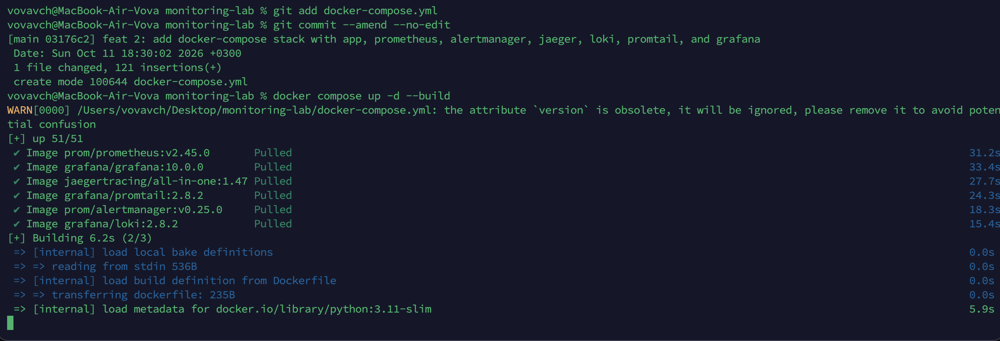

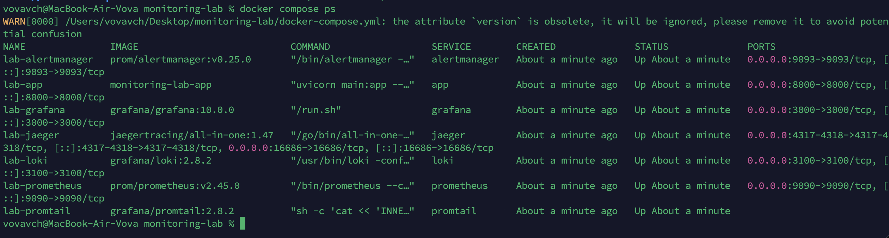

## 6. Prometheus и метрики RED

Prometheus использует pull-модель: он сам обращается к endpoint приложения через заданный интервал и забирает метрики. В `prometheus.yml` задаются интервал опроса и адрес цели. Пример:

```yaml
global:
  scrape_interval: 5s
  evaluation_interval: 5s

scrape_configs:
  - job_name: "fastapi"
    metrics_path: /metrics
    static_configs:
      - targets: ["app:8000"]
```

`app` в примере — имя сервиса в Compose. Внутри контейнера Prometheus адрес `localhost` указывал бы на сам Prometheus, а не на FastAPI. Поэтому для связи контейнеров в одной Compose-сети используют DNS-имя сервиса. Интервал 5 секунд выбран для удобства лабораторного наблюдения: изменения быстрее появляются на графиках. В рабочей системе интервал выбирают с учётом нагрузки и требуемой детализации.

После запуска нужно открыть Prometheus и проверить **Status → Targets**. Цель приложения должна иметь состояние `UP`. Если она `DOWN`, проверяются имя сервиса, порт, `metrics_path`, доступность `/metrics` и логи приложения.

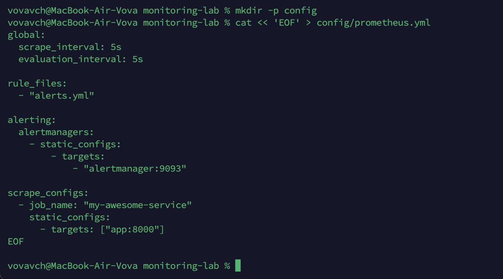

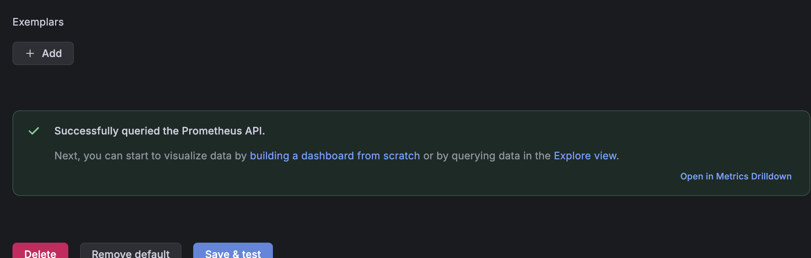

### 6.1. Rate, Errors, Duration

Для оценки HTTP-сервиса используется подход **RED** — Rate, Errors, Duration.

**Rate** — интенсивность запросов. Для счётчика `http_requests_total` скорость поступления запросов можно оценить так:

```promql
sum(rate(http_requests_total[1m]))
```

`rate()` вычисляет среднюю скорость увеличения счётчика за временное окно. Результат выражения — запросы в секунду. При вызове `/load` ожидается кратковременный всплеск.

**Errors** — частота ошибок. Если приложение отдельно считает ответы с ошибками в `http_errors_total`, запрос выглядит так:

```promql
sum(rate(http_errors_total[1m]))
```

Чтобы оценить долю ошибок от общего потока запросов, можно использовать:

```promql
sum(rate(http_errors_total[1m]))
/
clamp_min(sum(rate(http_requests_total[1m])), 1)
```

`clamp_min` не позволяет делить на ноль в периоды отсутствия запросов. Имена метрик здесь должны совпадать с теми, которые реально экспортирует приложение; если в коде они названы иначе или содержат labels, PromQL нужно адаптировать.

**Duration** — длительность обработки. Для histogram-метрики `http_request_duration_seconds_bucket` 95-й перцентиль можно получить запросом:

```promql
histogram_quantile(
  0.95,
  sum by (le) (rate(http_request_duration_seconds_bucket[5m]))
)
```

`rate()` рассчитывает скорость роста счётчиков корзин за последние пять минут, `sum by (le)` агрегирует их по границам корзин, а `histogram_quantile(0.95, ...)` оценивает p95.

### 6.2. Почему p95, а не среднее

Среднее арифметическое может скрывать проблемы медленной части запросов. Например, если 95 запросов выполняются за 100 мс, а 5 запросов — за 3 секунды, среднее значение будет выглядеть относительно приемлемо, хотя каждый двадцатый пользователь столкнётся с долгим ожиданием.

**p95 — это значение, быстрее которого завершаются примерно 95% запросов.** Оставшиеся 5% могут быть медленнее. Поэтому p95 показывает хвост распределения и помогает заметить деградацию, которую среднее сглаживает. При этом p95 менее чувствителен к единичному экстремальному запросу, чем максимум.

Для полноценного анализа полезно смотреть p50, p95 и p99 вместе с количеством запросов. Перцентиль не объясняет причину задержки, а лишь показывает её наличие. Кроме того, точность оценки зависит от количества наблюдений и границ histogram-корзин. Для поиска конкретного медленного участка нужен trace в Jaeger.

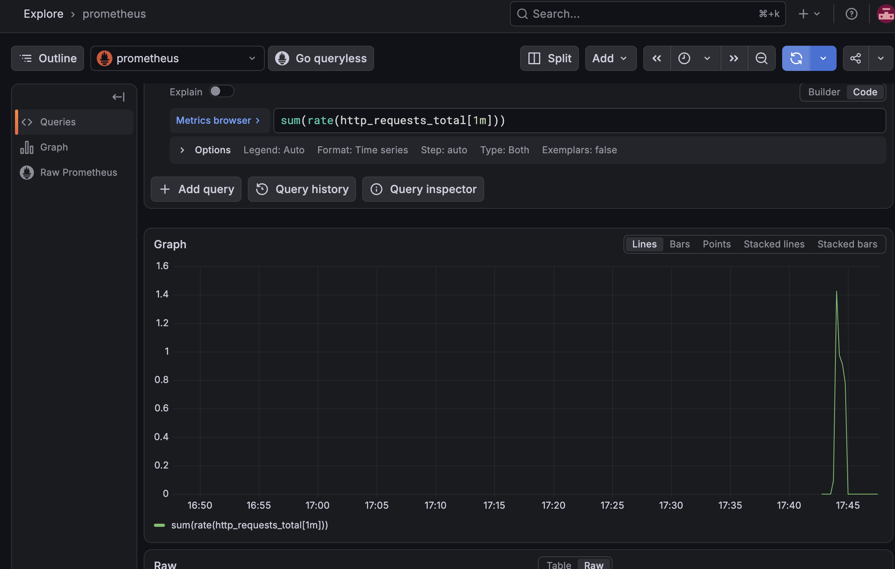

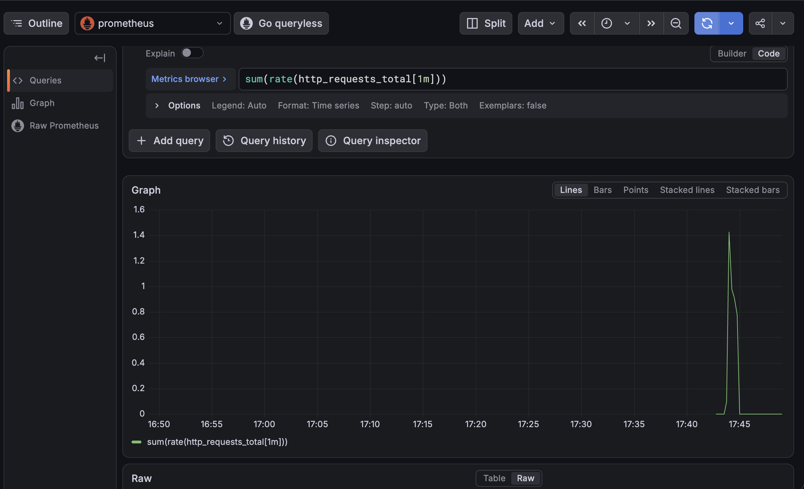

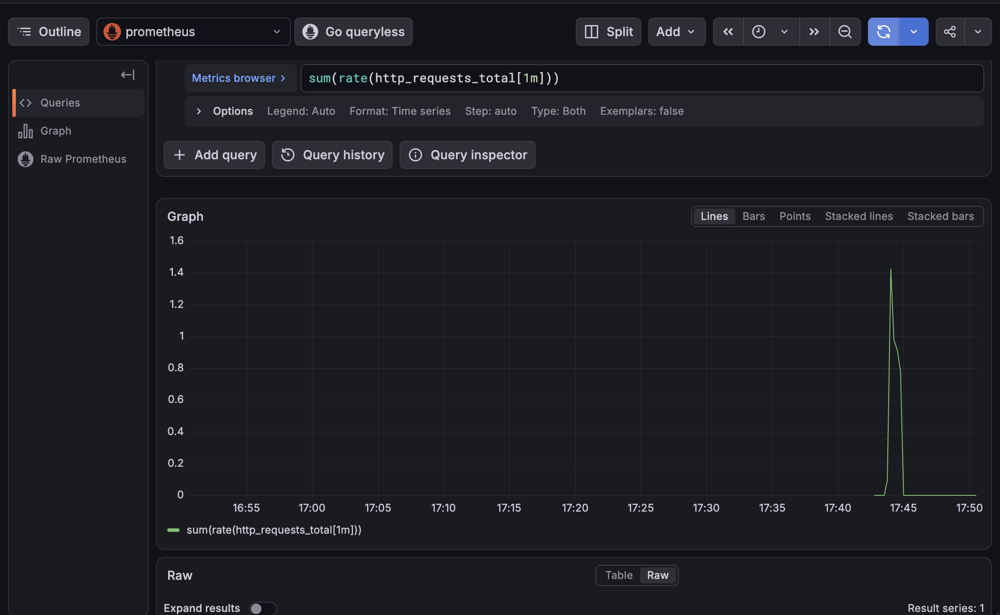

## 7. Grafana: визуализация метрик

Grafana подключается к Prometheus как к Data source. Если оба компонента находятся в одной Compose-сети, URL источника обычно имеет вид `http://prometheus:9090`, где `prometheus` — имя сервиса в `docker-compose.yml`.

Важно различать адреса с точки зрения браузера и контейнера. Браузер открывает Grafana через опубликованный host-порт, но запросы Grafana к Prometheus выполняются из контейнера Grafana. Поэтому в URL источника используется внутреннее DNS-имя Compose-сервиса, а не `localhost`.

После добавления источника выполняется проверка соединения. Затем импортируется дашборд. Импорт готовой панели ускоряет работу, но не гарантирует корректность: нужно проверить выбранный datasource и убедиться, что PromQL-запросы используют метрики, которые действительно экспортирует приложение.

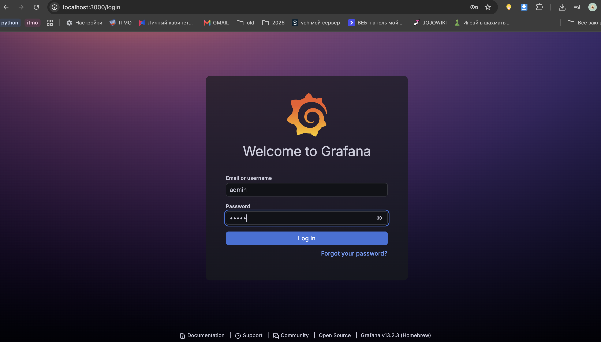

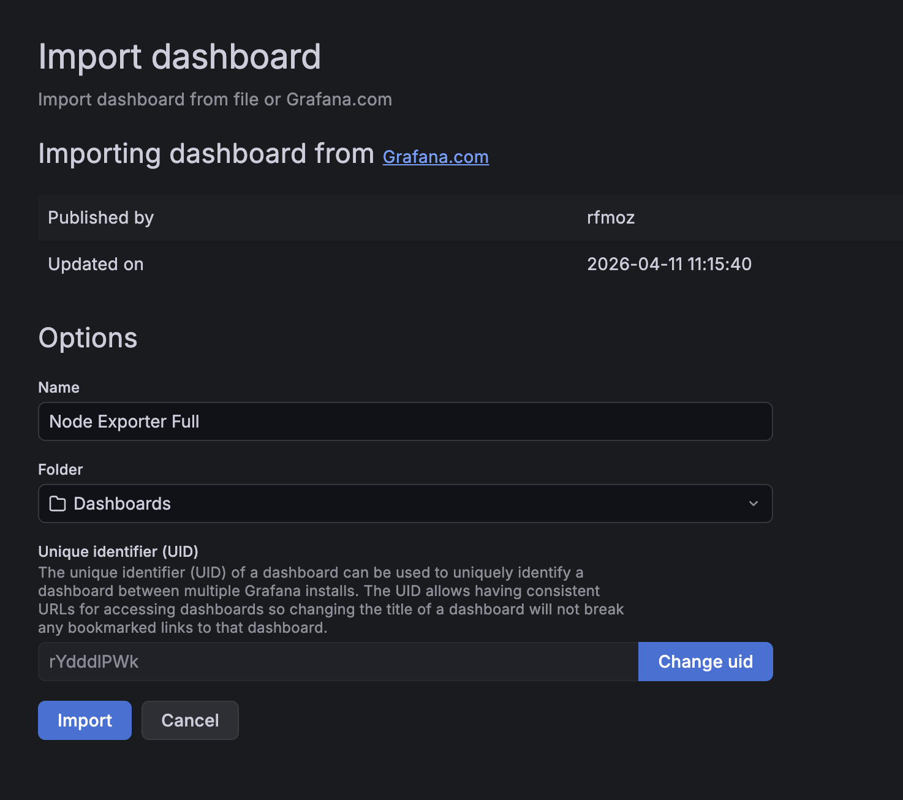

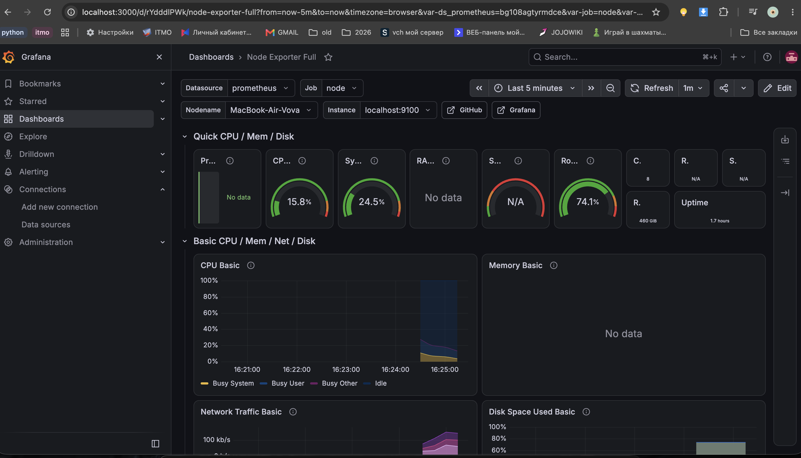

## 8. Jaeger и распределённая трассировка

Метрики показывают, что выросла задержка или количество ошибок, но не всегда объясняют причину. Для этого используется distributed tracing.

Trace описывает путь одного запроса и состоит из spans. Каждый span соответствует отдельной операции и содержит время начала, длительность, атрибуты и, при необходимости, информацию об ошибке. Спаны связаны отношением родитель–потомок и образуют дерево.

Приложение отправляет трассировки в Jaeger по OTLP gRPC. При настройке экспортёра важно указывать адрес Jaeger Collector, доступный именно из контейнера приложения, и правильный OTLP gRPC-порт. Порт веб-интерфейса Jaeger и порт приёма OTLP — разные назначения, их нельзя путать.

Для `/delay` в Jaeger можно открыть trace и посмотреть вложенный `slow-dependency`. Если этот span занимает значительную часть общей длительности, становится понятно, какая операция добавляет задержку. Это более полезный вывод, чем просто констатация «ответ стал медленным».

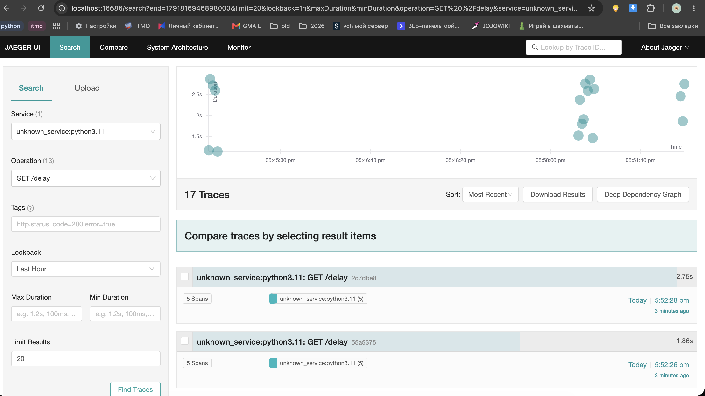

### 8.1. Трассировка ошибки

При вызове `/error` сервис намеренно возвращает HTTP 500. В Jaeger можно найти соответствующую трассировку и изучить статус и атрибуты HTTP-операции. Это помогает отличать ошибку на уровне HTTP от сбоя внутри отдельной зависимости. Чем подробнее инструментированы операции, тем точнее можно локализовать место возникновения проблемы.

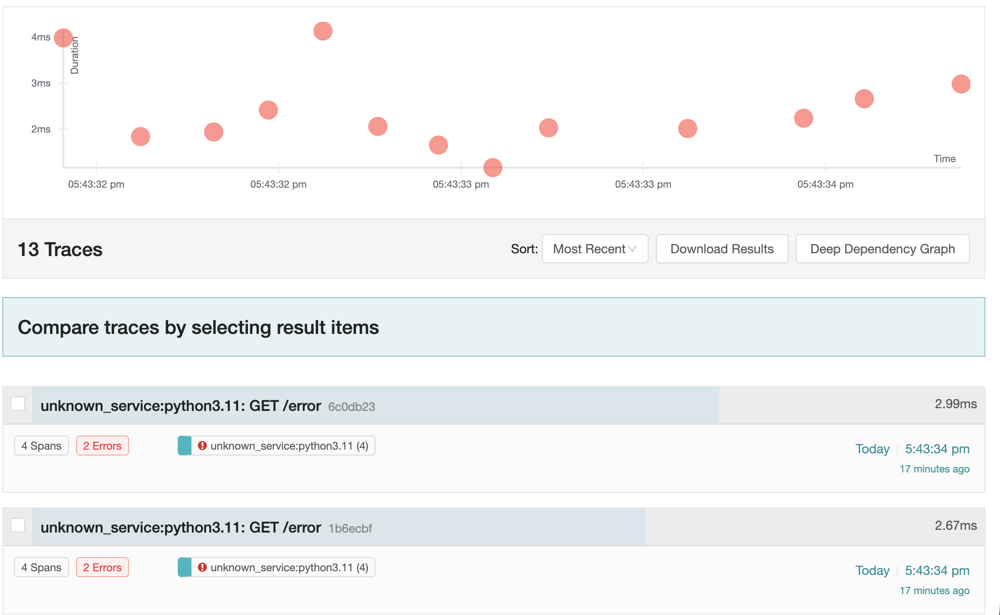

## 9. Loki и Promtail: централизованные логи

Метрики дают агрегированную картину, а трейсы — структуру отдельного запроса. Логи дополняют их конкретными сообщениями приложения. В проекте используются структурированные JSON-записи. Например, запись может иметь такую форму:

```json
{
  "level": "ERROR",
  "service": "fastapi",
  "message": "Request failed",
  "trace_id": "0123456789abcdef0123456789abcdef",
  "path": "/error",
  "status_code": 500
}
```

Это пример структуры, а не конкретная запись из запуска. Важно, чтобы приложение добавляло `trace_id` активной трассировки в лог при обработке запроса. Тогда по идентификатору можно перейти от ошибки в логе к соответствующему trace в Jaeger.

Promtail читает выбранный источник логов, при необходимости разбирает JSON и отправляет записи в Loki. Loki хранит их и позволяет искать по labels и содержимому. Не стоит без необходимости превращать `trace_id` в постоянную label: это уникальное значение для большого количества запросов, и высокая cardinality может ухудшить работу Loki. Для labels лучше подходят относительно стабильные значения вроде `service` и `level`, а `trace_id` можно извлекать как поле записи.

### 9.1. Особенность Docker Desktop на macOS

При настройке Promtail возникла проблема с путём `/var/lib/docker/containers`. Он типичен для Linux-хоста, но Docker Desktop на macOS запускает Docker Engine внутри Linux VM. Поэтому этот каталог не является обычной директорией macOS и не становится автоматически доступным контейнеру Promtail через bind mount.

Здесь важно различать три файловых пространства: macOS, Linux VM Docker Desktop и файловую систему отдельного контейнера. Путь, существующий внутри Docker Engine, не обязательно существует на Mac и не обязательно доступен другому контейнеру.

Для локального стенда нужно явно предоставить Promtail доступный источник логов. Один из понятных вариантов — общий том с файлами JSON-логов приложения: приложение пишет в каталог, а тот же каталог монтируется в Promtail только для чтения. Тогда путь в `__path__` конфигурации Promtail должен указывать на реальный путь **внутри контейнера Promtail**, а host path должен соответствовать существующей директории проекта. Нельзя исправить проблему простым созданием пустого `/var/lib/docker/containers` на Mac: это не даст доступа к логам Docker Engine внутри VM.

## 10. Alertmanager и правила оповещений

Prometheus отвечает за вычисление условий, а Alertmanager — за дальнейшую обработку уведомлений: группировку похожих событий, подавление повторов и маршрутизацию в receiver.

Пример тестового правила для счётчика ошибок:

```yaml
groups:
  - name: fastapi-alerts
    rules:
      - alert: FastAPIHighErrorRate
        expr: sum(rate(http_errors_total[1m])) > 0
        for: 30s
        labels:
          severity: warning
        annotations:
          summary: "FastAPI возвращает ошибки"
          description: "За последнюю минуту обнаружены HTTP-ошибки."
```

Это демонстрационный вариант, а не универсальный production-порог. Для реального сервиса обычно оценивают долю ошибок и выбирают порог с учётом SLO. Важен и параметр `for`: он требует, чтобы условие оставалось истинным заданное время.

Для проверки цепочки нужно убедиться, что Prometheus загрузил правила, alert появился в его разделе Alerts, а затем проверить его состояние в интерфейсе Alertmanager.

**Скриншот Alertmanager:** в приложенном архиве отдельного изображения с карточками Alertmanager не оказалось. После добавления такого скриншота в каталог `images/` раскомментируйте или используйте следующую ссылку, заменив имя файла при необходимости:

```markdown

```

### 10.1. Почему одиночный клик не всегда приводил к срабатыванию

При тестировании выяснилось, что одиночный вызов `/error` не всегда приводил к ожидаемому переходу алерта в `firing`. Это не обязательно означает, что сломана доставка в Alertmanager. Нужно учитывать, как вычисляется само выражение PromQL.

`rate()` рассчитывает скорость изменения счётчика на временном окне. Prometheus видит новое значение только после очередного scrape. При редких одиночных событиях результат зависит от интервала сбора, выбранного окна и наличия samples. Кроме того, `for` задерживает переход в firing до тех пор, пока условие не остаётся истинным заданное время.

Для проверки именно прохождения алерта до Alertmanager временно использовалось выражение:

```promql
changes(http_errors_total[1m]) > 0
```

`changes()` считает, сколько раз значение временного ряда изменилось за указанный интервал. Если счётчик ошибок изменился хотя бы один раз, условие становится истинным. Для ручного теста это удобнее, чем проверять скорость прироста.

Но `changes()` — не замена `rate()` для оценки интенсивности ошибок. Это диагностическое условие на факт изменения значения. После проверки доставки алерта правило следует вернуть к осмысленному порогу, подходящему под требования сервиса. Также следует учитывать `for`: при `for: 30s` переход не будет мгновенным даже при истинном выражении.

## 11. Трудности, с которыми я столкнулся

### 11.1. Недоступность `/var/lib/docker/containers` на macOS

Сначала возникла проблема с тем, что Promtail не мог прочитать стандартный каталог Docker-логов. В Linux-инструкциях часто предполагается, что `/var/lib/docker/containers` доступен на хосте. На macOS с Docker Desktop это предположение неверно: Docker Engine находится внутри Linux VM, а не работает непосредственно в файловой системе macOS.

Решение — не создавать фиктивную директорию на Mac, а настроить источник логов, реально доступный Promtail. Для лабораторного стенда подходит общий том с JSON-логами приложения. При этом нужно согласовать host path, путь монтирования в контейнер и `__path__` в конфигурации агента. Этот случай помог разобраться, что bind mount связывает конкретные файловые системы, а Docker Desktop добавляет между хостом и контейнерами виртуализационный слой.

### 11.2. Дублирование ключа `volumes` в YAML

При редактировании сервиса Promtail в `docker-compose.yml` YAML-парсер выдал ошибку из-за повторного ключа `volumes` на одном уровне вложенности. В YAML повторный ключ не означает «добавить ещё один список»: это дублирование одного и того же поля.

Ошибочная структура:

```yaml
services:
  promtail:
    volumes:
      - ./promtail/promtail-config.yml:/etc/promtail/config.yml
    volumes:
      - ./logs:/var/log/app
```

Правильный вариант — один ключ `volumes` и все подключения в одном списке:

```yaml
services:
  promtail:
    volumes:
      - ./promtail/promtail-config.yml:/etc/promtail/config.yml
      - ./logs:/var/log/app
```

После исправления я проверял структуру командой:

```bash
docker compose config
```

Она разбирает Compose-файл и выводит итоговую конфигурацию. Если эта команда завершается ошибкой, запускать весь стенд ещё рано — сначала нужно исправить YAML.

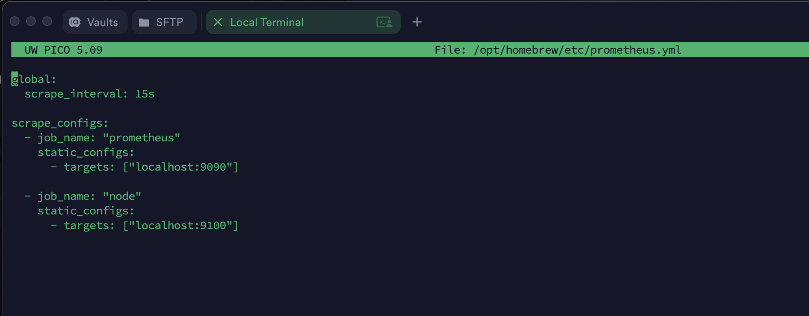

### 11.3. Ошибка PromQL `parse error: unexpected <op:/>`

При составлении запроса Prometheus появилась ошибка `parse error: unexpected <op:/>`. Причина была в случайном вводе URL хоста вместо имени метрики `http_errors_total`. PromQL — отдельный язык запросов: он ожидает имена метрик, функции, labels и операторы. URL вида `http://...` не является именем метрики, а символ `/` парсер воспринимает как оператор деления.

Исправление — использовать имя временного ряда:

```promql
http_errors_total
```

Или запрос скорости прироста:

```promql
rate(http_errors_total[1m])
```

После этого выражение нужно проверить в Expression browser. Если синтаксис уже корректен, но результат пустой, это другая проблема: метрика может не поступать, называться иначе или не иметь samples за выбранный интервал. Поэтому важно отдельно проверять синтаксис запроса и наличие данных.

### 11.4. Алерт не срабатывал после одиночного нажатия

Одиночное нажатие `/error` не всегда приводило к быстрому срабатыванию алерта. Причина заключалась в сочетании временного окна `rate()`, интервала scrape и параметра `for`. Счётчик увеличивается в момент запроса, но Prometheus узнаёт об этом при очередном опросе. Затем `rate()` оценивает скорость на выбранном окне, а `for` дополнительно требует выдержать условие некоторое время.

Чтобы проверить саму доставку алерта, временно использовали:

```promql
changes(http_errors_total[1m]) > 0
```

Так проверялся факт изменения счётчика за последнюю минуту. Это упростило тестирование связки Prometheus → Alertmanager. При этом для рабочего алертинга нужно использовать метрику интенсивности или доли ошибок и адекватный порог, а `changes()` оставить как диагностический приём.

## 12. Итоговая проверка стенда

Проверку удобнее выполнять по цепочке, а не начинать с дашборда. Если Grafana показывает пустой график, причина может находиться в приложении, Prometheus, datasource или самом PromQL-запросе.

1. Проверить контейнеры:

   ```bash
   docker compose ps
   ```

2. Посмотреть логи приложения и агентов:

   ```bash
   docker compose logs --tail=100 app
   docker compose logs --tail=100 prometheus
   docker compose logs --tail=100 promtail
   ```

3. Убедиться, что приложение отдаёт метрики (команда предполагает host port 8000):

   ```bash
   curl -s http://localhost:8000/metrics | head
   ```

4. В Prometheus проверить target `fastapi` — он должен быть `UP` — и выполнить запрос к одной из известных метрик.
5. В Grafana проверить datasource и убедиться, что панели получают данные.
6. Вызвать `/delay`, открыть trace в Jaeger и найти вложенный `slow-dependency`.
7. Вызвать `/error`, сопоставить трассировку с ростом счётчика ошибок.
8. Проверить поступление JSON-логов в Loki и наличие в них `trace_id`.
9. Проверить прохождение тестового алерта от правила Prometheus до Alertmanager.

Порты в примерах нужно сверять с `ports` в собственном `docker-compose.yml`: если host port отличается от 8000, в `curl` используется опубликованный порт.

## 13. Вывод

Главный результат лабораторной для меня — понимание, что мониторинг не должен сводиться к одному дашборду. График может показать, что время ответа выросло, но не объяснить причину. RED-метрики дают быстрый ответ о состоянии HTTP-сервиса: сколько запросов приходит, какая часть завершается ошибкой и сколько времени занимает обработка. Но для поиска первопричины нужны дополнительные сигналы.

Трейсинг позволяет пройти по внутреннему пути конкретного запроса. Например, при тестировании `/delay` недостаточно увидеть рост p95. В Jaeger можно открыть отдельную трассировку, посмотреть дерево спанов и обнаружить, что значительную часть времени занимает `slow-dependency`. Это уже указывает на конкретную операцию, которую нужно исследовать.

Логи добавляют контекст. Сообщение об ошибке полезно само по себе, но особенно ценно, когда в нём есть `trace_id`. По этому идентификатору можно найти соответствующий trace в Jaeger и сопоставить текст ошибки с последовательностью операций. Получается связка: метрика показывает отклонение, trace помогает найти участок, где возникла задержка или ошибка, а лог объясняет, какое событие зарегистрировало приложение.

Именно совместное использование сигналов делает Observability полезной на практике. Без общей связи инженер вынужден отдельно смотреть графики, отдельно читать логи и гадать, относятся ли они к одному запросу. `trace_id` даёт общий контекст и сокращает путь от обнаружения проблемы до её локализации.

Лабораторная также показала, что инфраструктурные инструменты требуют понимания среды. Конфигурация Promtail для Linux не обязательно подходит Docker Desktop на macOS; YAML чувствителен к структуре; PromQL имеет собственный синтаксис и временные окна; а алерт зависит не только от факта ошибки, но и от scrape interval, выражения и параметра `for`.

В итоге получился локальный стенд, на котором можно воспроизводить ошибку, задержку и всплеск нагрузки, а затем наблюдать их через несколько взаимодополняющих инструментов. Для меня важен не только факт запуска контейнеров, но и понимание роли каждого компонента и того, как использовать их вместе для диагностики микросервиса.

## 14. Полезные команды

```bash
# Перейти в каталог проекта
cd ~/monitoring-lab

# Проверить Compose-конфигурацию
docker compose config

# Собрать образы и запустить стенд
docker compose up -d --build

# Посмотреть состояние контейнеров
docker compose ps

# Следить за логами
docker compose logs -f

# Посмотреть последние 100 строк логов приложения
docker compose logs --tail=100 app

# Перезапустить один сервис
docker compose restart prometheus

# Пересоздать контейнер Promtail после изменения конфигурации
docker compose up -d --force-recreate promtail

# Остановить стенд, сохранив именованные тома
docker compose down

# Проверить состояние Git
git status

# Зафиксировать изменения
git add .
git commit -m "Update monitoring lab documentation"
```


